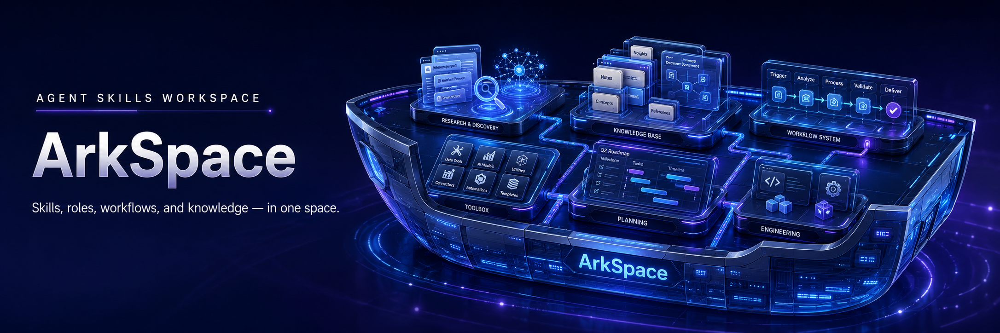

# ArkSpace

<p>
  <a href="README.md">English</a> ·
  <a href="INSTALL.md">安装</a> ·
  <a href="docs/architecture.md">架构</a> ·
  <a href="CONTRIBUTING.md">贡献</a>
</p>



[](https://www.npmjs.com/package/@arkspace/cli)
[](package.json)
[](LICENSE)

**面向 Web 证据、引用研究、浏览器操作与监控的可复用 Agent Skills；只有在需要共享 Provider 执行时，才通过统一且安全的本地边界运行。**

ArkSpace 为 Coding Agent 提供聚焦的操作说明，而不是一个巨型 Prompt。首个版本包含五个 canonical Skills 与 `arks` CLI；CLI 负责协调 Provider 凭证、多 Key 轮询、fallback、远程资源所有权和机器可读结果。

## 两分钟开始使用

### 让 Agent 安装

将下面内容粘贴到 Coding Agent：

```text
请按照仓库 INSTALL.md 的说明，从 https://github.com/arch3rPro/Ark-Space 安装 ArkSpace。修改我的全局 Package、Agent 配置或 MCP 配置前先征得同意。绝对不要要求我在当前对话中粘贴 API Key。需要凭证时，请停下来，让我在可信的本地终端中亲自运行 `arks setup`。只有在我确认完成后才能继续。宣布成功前，请验证 CLI、已安装 Skills 和 Provider readiness。
```

### 或者自行安装

功能、验证证据与验收限制见 [0.1.5 版本说明](release/0.1.5.md)。

```bash
npm install --global @arkspace/cli@latest
npx skills@latest add arch3rPro/Ark-Space
```

然后亲自在可信的本地终端中运行凭证向导：

```bash
arks setup
arks doctor
arks web search "agent skills"
```

> **不要在 Agent 对话中输入 API Key。** `arks setup` 使用隐藏终端输入，并将本地凭证与配置和状态分开存储。CI 与外部 Secret 管理仍可使用环境变量。

Host 安装、验证、更新、卸载、MCP 和凭证细节见 [INSTALL.md](INSTALL.md)。0.1.5 发布候选源码新增手动 npm CLI 更新检查与安装；已发布的 0.1.4 不包含更新器，也不表示候选版本已在 npm 上架。请使用 `@latest` 安装 CLI，并单独更新 Skills。

### 检查与更新已安装的 Skills

对于通过 Skills CLI 安装的技能：

```bash
npx skills@latest check   # 检查可用的技能更新
npx skills@latest update  # 手动更新已安装的技能
```

这些命令作用于安装工具跟踪的 Skills，不只限于 ArkSpace。更新前请备份本地改动；`npx` 可能下载工具并写入缓存。CLI 更新单独进行，Codex／Claude 原生插件则使用各自宿主的插件更新机制。

## 按目标选择 Skill

| Skill | 用途 |
| --- | --- |
| [`askme`](skills/askme/SKILL.md) | 澄清影响结果的需求歧义，保持已确认约束，并纠正执行偏差。 |
| [`web`](skills/web/SKILL.md) | 查找、读取、发现、抓取或提取公共 Web 与实现证据。 |
| [`research`](skills/research/SKILL.md) | 综合多个公共来源，产出有边界、带引用的报告。 |
| [`browser`](skills/browser/SKILL.md) | 在自有远程浏览器 Session 中读取或改变动态页面状态。 |
| [`monitor`](skills/monitor/SKILL.md) | 管理跨越当前 Session 的周期搜索与站点变化检查。 |
| [`weknora`](skills/weknora/SKILL.md) | 通过 REST API 检索、导入 WeKnora 知识库并基于其文档回答问题。 |
| [`gh-repo`](skills/gh-repo/SKILL.md) | 基于固定 revision 的源码证据分析 GitHub 项目架构、成熟度与借鉴取舍，并读取相关 issue/PR。 |

`askme` 是纯指导型 Skill：要求能够与用户继续对话，不需要 CLI、网络、凭证或兄弟 Skills。既可显式调用，也可由 Agent 在关键歧义或执行偏差出现时选择。明确的任务直接执行；需求对齐不会增加统一的批准步骤。

操作标识、Provider 覆盖、Fallback 行为和资源所有权见 [Skill、Capability 与 Provider 参考](docs/capabilities.md)。

### 可选托管 WeKnora 配置（0.1.4）

在可信的本地终端运行 `arks setup weknora`，管理 API 根地址、掩码密钥和可选默认知识库。托管的认证验证、列表/详情和搜索可连接有效的 localhost、私网或公网地址，无需 CIDR 例外；URL/地址校验、DNS 固定解析、TLS 验证、拒绝重定向、不使用代理、期限与响应大小限制，仍然适用。用户明确请求读取已配置实例即表示同意联网；支持 HTTP，并仅显示明文传输提示。托管路径不加入 Web 搜索顺序或 fallback。

手动设置的 `WEKNORA_BASE_URL` / `WEKNORA_API_KEY` 完整变量对仍可独立使用，无需 CLI。导入、文档/分块操作、多知识库搜索和流式问答继续使用环境变量路径；托管验证、知识库列表/详情和单知识库搜索为可选能力。详见[安装说明](INSTALL.md)和[托管指南](skills/weknora/references/managed.md)。

## Runtime 提供什么

Skill 可以保持纯指导、自带独立脚本、使用外部应用，或调用 ArkSpace 共享能力。只有最后一种模式要求 `arks`。

```text
Agent Host
  └─ Agent Skill
      ├─ Host 工具 / Skill 自带脚本 / 外部工具
      └─ arks invoke <capability> --input <file>
          ├─ Provider-neutral Capability Handler
          ├─ Exa / Tavily / Firecrawl / SearXNG Adapter
          └─ Credentials、Key Pool、Fallback 与 Owned State
```

共享 Runtime 提供：

- **稳定机器输出：** stdout 只输出一个 Protocol v1 JSON Envelope；诊断进入 stderr。
- **凭证隔离：** Setup 在人类控制的终端完成，Config 与 State 仅保留引用和非敏感元数据。
- **多 Key 管理：** 事务式轮询选择、Cooldown、Disable State 与分类 Fallback。
- **真实的远程生命周期：** Timeout、Cancellation、Acceptance Unknown、Partial Output 与 Cleanup 是不同结果。
- **资源所有权：** Browser Session 与 Monitor 绑定创建它们的凭证，重要副作用需要确认。
- **统一 MCP Adapter：** `arks mcp serve` 暴露同一个 Dispatcher，不复制 Provider 逻辑。

## 人类与机器入口

面向人类的命令注重可发现性：

```bash
arks provider list
arks web fetch "https://example.com/docs"
arks web crawl "https://docs.example.com" --max-pages 20 --max-depth 2
arks code context "current TypeScript SDK usage"
arks research run "compare current agent research APIs" --depth standard
arks browser open "https://example.com"
arks monitor status <monitor-id>
```

Skills 使用稳定的机器边界：

```bash
arks invoke web.search --input search-request.json
arks invoke research.run --input research-request.json
arks invoke browser.open --input browser-open-request.json
arks invoke monitor.create --input monitor-create-request.json
```

Protocol Schema 发布在 [`schemas/protocol/v1/`](schemas/protocol/v1/) 下。

## 安装方式

- **Portable Skills：** 兼容文件系统 Skill 的 Host 可通过 Agent Skills Installer 安装 canonical `skills/` 目录。
- **Claude Code Plugin：** 仓库 Marketplace Manifest 直接引用 canonical Skills。
- **Codex Plugin Metadata：** `.codex-plugin/plugin.json` 指向同一个 canonical 目录。
- **MCP stdio：** Claude Code、Codex 和其他 MCP Host 可在需要工具发现时注册 `arks mcp serve`。

项目不维护生成式 Plugin 镜像。日常 Skill 修改直接更新 canonical source；只有明确发布时才修改 Plugin 版本元数据。

## 安全模型

- 不在 Agent 问答、Chat Message、命令参数、Fixture 或版本控制文件中输入 API Key。
- `arks setup` 将本地 Key 写入用户级 `credentials.json`，并在系统支持时设置限制性权限。
- 显式环境变量覆盖本地存储值。
- `config.json` 保存凭证引用；`state.json` 保存匿名 Key ID 和生命周期元数据。
- Browser 与 Monitor Mutation 需要显式确认；Cleanup 与不确定的远程结果保持可见。

本地 Credential File 包含明文 Secret，并不等同于操作系统 Keychain。为受管环境选择凭证策略前，请阅读 [ADR 0009](docs/adr/accepted/0009-local-credential-setup.md) 与 [Security Policy](SECURITY.md)。

## 版本状态与限制

**0.1.5 发布候选版本相较 0.1.4 的变化**包括手动 npm CLI 更新、改进的有界研究证据审阅，以及 Skill 图标和调用策略。验证证据与验收限制详见[版本说明](release/0.1.5.md)。0.1.4 新增了可选托管 WeKnora 验证与检索能力，详见[0.1.4 版本说明](release/0.1.4.md)。

0.1.3 随免 Key 的 SearXNG 交付了重建后的 Setup TUI。0.1.5 将该工作台迁移到差分渲染引擎，三轴交互契约保持不变：Top、Menu、Content 三个焦点区域以 Tab/Shift-Tab 循环；菜单分五个页面（搜索引擎、知识库、工具库、设置、退出），菜单方向键实时切换页面，Enter 仅进入内容区；Top 条跟随页面变化——搜索引擎页为 [Exa] [Tavily] [Firecrawl] [SearXNG] [Order] 标签（搜索顺序与引擎并列为标签），知识库/工具库为单标签，其余页面居中显示全称——`arks setup <上下文>` 仍可直接深入任一页面。安全语义不变：掩码密钥草稿与显式覆盖确认（默认 Cancel）、Provider 与 Key 启停开关、默认 Cancel 的测试选择器（一次轮询池测试，或按引用逐个隔离测试——每引用一次请求，Esc 可停止）、SearXNG 按实例的私有 CIDR 授权（永不跨端点迁移）、WeKnora 端点/密钥/知识库行与需同意的在线验证、UseGPT 状态/启停/诊断及离线的隧道 ID、数据目录、密钥与解绑管理、仅调序的搜索路由与逐引擎启用/停用（每次保存一次隐私确认，SearXNG 默认参与路由）、仅存会话的诊断记录（显示在各引擎页密钥列表下方）。打开 setup 永不发起网络请求；非 TTY 输出仅一行纯文本、绝不进入备用屏；退出时始终恢复终端状态。Linux 自动 PTY 验收通过 `npm run test:setup` 覆盖全部页面，分别针对源码构建与离线安装入口；真人易用性、真实服务及托管 Windows/macOS 终端仍未验收。交互与安全契约见 [ADR 0016](docs/adr/accepted/0016-tui-provider-setup.md) 与 [ADR 0017](docs/adr/accepted/0017-workbench-modal-setup.md)，引擎与呈现决策见 [ADR 0023](docs/adr/accepted/0023-pi-tui-setup-engine.md) 与 [ADR 0024](docs/adr/accepted/0024-workbench-presentation-contract.md)，参考来源见 [NOTICE.md](NOTICE.md)。

按照 [INSTALL.md](INSTALL.md#source-development) 构建当前源码，然后运行 `node dist/cli/main.js setup`（或附加 `exa`、`tavily`、`firecrawl`、`searxng`），无需替换全局安装。密钥预览、环境变量优先级、所有权保护、SearXNG 每实例窄 CIDR 授权、联网测试同意、取消与终端恢复等既有保障继续有效；真人易用性、真实服务和 Windows/macOS 终端仍未验收。

当前限制：

- Node.js 20 或更高版本，以及具备 Shell、网络和持久用户存储的本地 Host 是必需的。可选的 UseGPT Artifact Hub 使用无需标志的 `node:sqlite`，因此要求 Node.js 22.13.0 或更高版本。
- Exa、Tavily、Firecrawl 操作需要对应账号，并可能产生 Provider 费用；SearXNG 搜索则需要显式配置实例。
- 免 Key 的 Exa MCP 接入与 Tavily/Firecrawl OAuth 仅为研究主题，尚未实现为认证后端。
- Hosted Cross-platform 与 Credentialed Live-provider Qualification 仍属于[发布后待办](docs/migration.md#post-release-01-qualification-backlog)。
- 本版本不代表现有 ArkSpace 项目已经完成替换切换。

## 项目指南

| 需求 | 阅读 |
| --- | --- |
| 安装、验证、更新或卸载 | [安装说明](INSTALL.md) |
| 理解边界和执行模式 | [架构](docs/architecture.md) |
| 查看迁移和切换门槛 | [迁移计划](docs/migration.md) |
| 查看 0.1 证据与阻塞项 | [0.1 版本证据](docs/migration/v1-evidence.md) |
| 记录实际使用中的阻力与优化证据 | [Field Testing Log](docs/field-testing.md) |
| 新增或设计 Skill | [Adding Skills](docs/adding-skills.md) |
| 配置 MCP stdio | [MCP Transport](docs/mcp.md) |
| 查看目标 Host 与 OS 支持 | [Platform Support](docs/platform-support.md) |
| 理解维护与发布规则 | [Maintenance](docs/maintenance.md) |

## 开发

```bash
git clone https://github.com/arch3rPro/Ark-Space.git
cd Ark-Space
npm install
npm run check
```

修改项目前请阅读 [CONTRIBUTING.md](CONTRIBUTING.md) 与 [AGENTS.md](AGENTS.md)。安全问题按照 [SECURITY.md](SECURITY.md) 报告。

## 许可证

ArkSpace 使用 [MIT License](LICENSE)。外部来源与 Attribution Notice 记录在 [NOTICE.md](NOTICE.md)。
